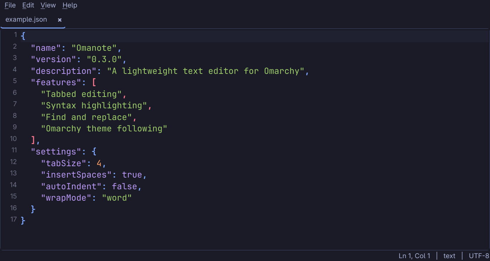

# Omanote

A lightweight text editor for Omarchy.



## Features

- Tabbed editing
- Syntax highlighting for common languages (toggle)
- Line numbers and current-line highlight (toggle)
- Bracket matching
- Right margin
- Find and replace
- Word wrap, zoom
- Go to line
- Auto-indent (configurable)
- Configurable tab size and spaces/tabs
- Smart Home/End
- Restore cursor position
- Ensure trailing newline on save
- Backup copies
- Autosave
- Print support
- Preferences dialog
- Omarchy theme following (accent, rounding, dark mode)

## Quick Start

```bash
git clone https://github.com/KimiAlva/omanote.git
cd omanote
./bin/build
./build/omanote
```

## Build

```bash
./bin/build
```

## Run

```bash
./build/omanote
```

## Install (from source)

```bash
./bin/install
```

Or install the prebuilt package from the latest release:

```bash
pkexec pacman -U omanote-<version>-1-x86_64.pkg.tar.zst
```

## Dependencies

- qt6-base
- qt6-wayland
- syntax-highlighting (KSyntaxHighlighting)

## Shortcuts

| Key | Action |
|---|---|
| Ctrl+N | New tab |
| Ctrl+O | Open |
| Ctrl+S | Save |
| Ctrl+Shift+S | Save as |
| Ctrl+W | Close tab |
| Ctrl+F | Find/Replace |
| Ctrl+G | Go to line |
| Ctrl++ / Ctrl+- | Zoom in/out |
| Ctrl+Q | Quit |
| Tab | Insert 4 spaces |

## License

MIT
```<|end|><|start|>write to=assistant<|channel|>analysis<|message|>Created file successfully: note/README.md